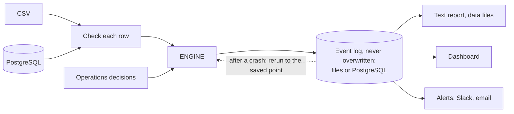
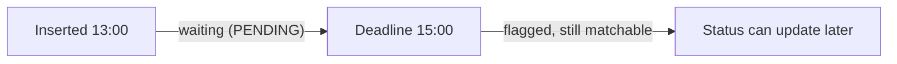
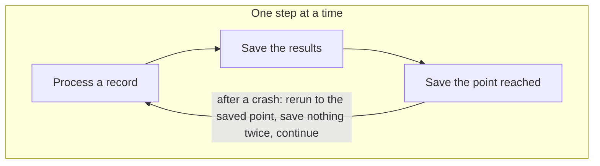
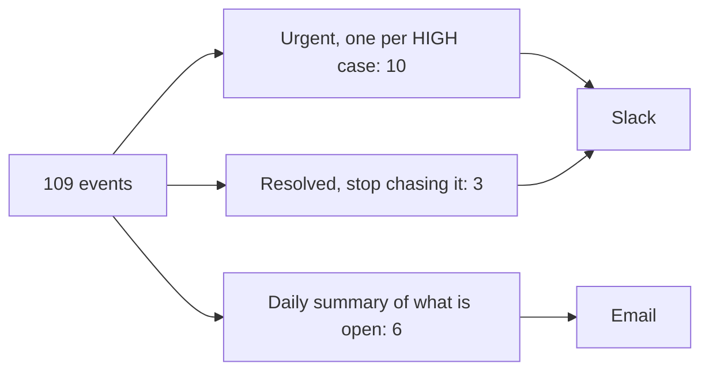
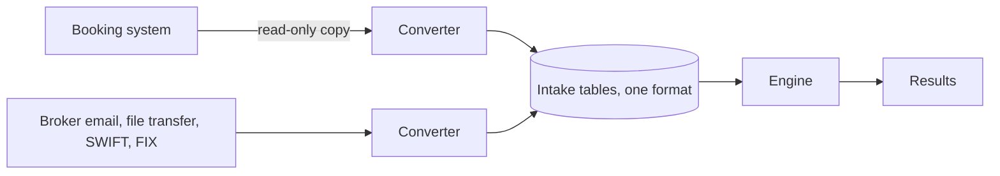

# What Counterfoil does

- Compares internal trades with broker confirmations, one record at a time, in arrival order.
- Gives every record a status within 2 hours.
- Tells Operations what is wrong, why, and what to do next.

| Status | Meaning |
| --- | --- |
| `PROCESSED` | Every term agrees, or Operations accepted it |
| `BREAK` | Same trade with 1-2 terms different, several adding up to one, or a tie |
| `UNCONFIRMED` | Booked, no confirmation |
| `UNBOOKED` | Confirmed, no booking: the position may be wrong |
| `POSSIBLE_DUPLICATE` | Identical to a booking already confirmed, traded within 5 minutes of it |

## 1. Design

- **PostgreSQL in and out:** `run --store postgres --source postgres` reads trades and confirmations from database tables and saves every result back to the database. `live` does the same continuously as new rows arrive.

## 2. Logic

### Every record follows this path

- Green: confirmed. Amber: a break. Orange: nothing to match it with.

### Time

- The clock follows `inserted_at`, the time a record arrives.
- The engine sees one record at a time.

### Each difference is explained, not just reported

| Difference | How it is read | Severity |
| --- | --- | --- |
| Price | Exactly 10, 100 or 1000 times: decimal point misplaced. Same digits reordered: typing error | HIGH |
| Volume | Off by a little: typo. Exact multiple: lots mixed up with units | HIGH |
| Currency | Wrong currency on one side: check with trader and broker | HIGH |
| Broker | Wrong broker selected, or broker confirmed a trade that is not theirs | HIGH |
| Fee | At most 0.01: rounding. One side zero: left out. Otherwise: wrong commission rate | MEDIUM |
| Trade date | Trade time after arrival: date typo. Otherwise late booking or time zone | MEDIUM |
| Trader | At least 80% similar: spelling (LOW). Otherwise a different person (MEDIUM) | LOW, MEDIUM |
| Instrument | Ticker versus name: same product (LOW). Otherwise a different product (HIGH) | LOW, HIGH |

### How serious each one is

- **HIGH:** affects position or cash, resolve today.
- **MEDIUM:** affects fees or record accuracy, including several records that add up to one.
- **LOW:** names only.
- **INFO:** no action needed.

## 3. Scenarios

| Area | Scenario | What the engine does |
| --- | --- | --- |
| Matching | New data contradicts a manual decision | The decision stands; a notice is raised |
| Input | Rules or inputs changed | Refused with a message, until `--fresh` |
| Input | Invalid or absurd row | Set aside with the reason; never dropped, never stops the run |
| System | Database connection lost (live) | Wait 1, 2, 4 ... 60 s, reconnect, catch up, continue |

**How a restart recovers**

## 4. Assumptions

1. One time zone; the data carries none.
2. Trade date is the date of `created_at`.
3. No buy/sell field and all volumes positive, so buying and selling are not compared.
4. No amend or cancel field. Same id, same content: resend, ignored. Same id, new content: set aside, never applied.
5. `trade_id` and `confirmation_id` are unique per file and unrelated to each other.
6. Trades, not positions or cash, are in scope: the data has neither.

## 5. Known limits and how to close them

| Limit | Potential fix | When it happens |
| --- | --- | --- |
| A restart reruns all history | Save the engine's state daily and rerun only what follows; a rule or code change means rerunning everything | Around 1 million records, when restart reaches about 2 minutes (measured on PostgreSQL: 4.6 s for 40,000, one laptop, test data) |

## 6. Notifications

- 109 is every status change and notice the engine recorded; 10 urgent alerts, 3 "resolved" follow-ups and 6 end-of-day summaries.

## 7. Production and extending

| To add | Change only |
| --- | --- |
| A data source | One converter writing to the intake tables |
| A limit | One field in `config.py`, one value in `config.yaml` |
| A new way to send alerts | One send function and one entry in `alerts.channels_from_env` |

| Next, in order | Why |
| --- | --- |
| Connect to the firm's databases automatically | Today PostgreSQL needs command options, and `load-db` to fill the engine's own tables. Read the firm's tables and save results with no manual step |
| Amendments and cancellations | Real systems send them; setting them aside does not scale. Add a version or action column |
| Buy/sell, then position and cash checks | The same design; this is where the money risk sits |
| Daily saved state | Rerun only from the last save, not all history |
| Official name lists | Fill the name tables from the firm's instrument and broker lists |
| A second person approves HIGH accepts; ignored alerts go to a manager | A manual accept changes the books |
| Monitoring | Is it running, how far behind is it, how old are open cases |
| Security | Passwords in a vault, encrypted connections, minimum access: converters only add data, Operations only submits requests |

