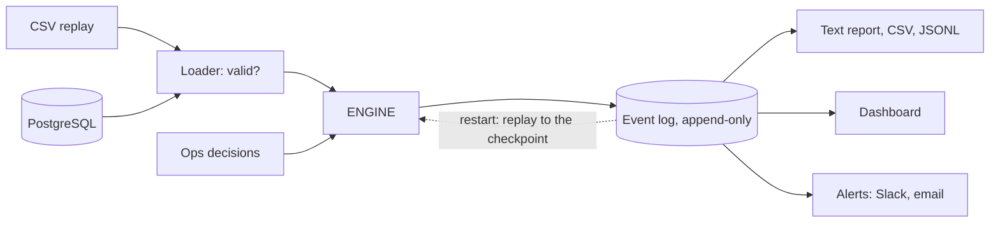
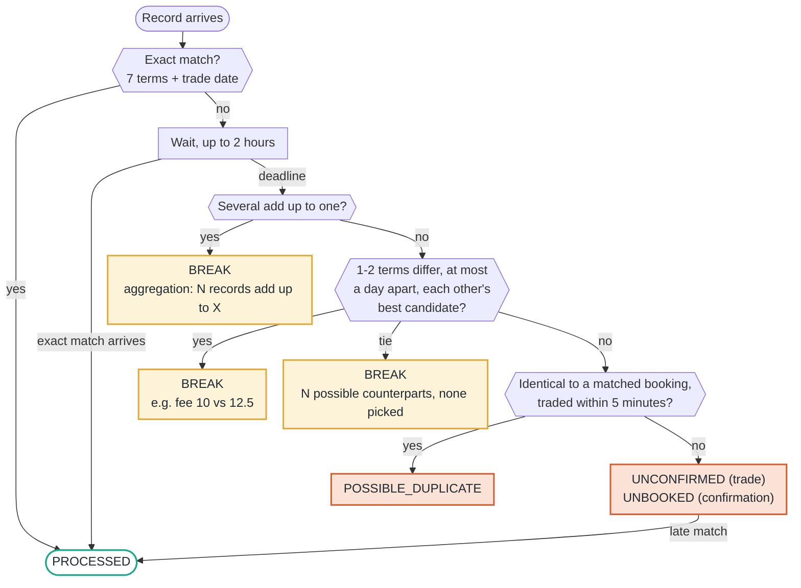
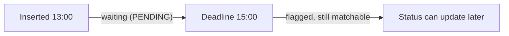
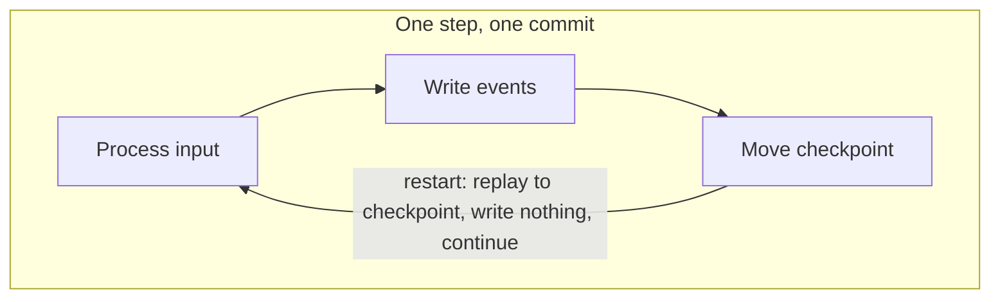
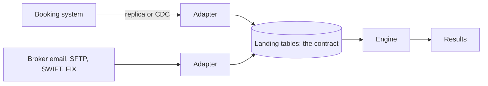

# What Counterfoil does

- Compares internal trades with broker confirmations, one record at a time, as if live.
- Gives every record a status within 2 hours.
- Tells Operations what is wrong, why, and what to do next.

| Status | Meaning |
| --- | --- |
| `PROCESSED` | Every term agrees, or Operations accepted it |
| `BREAK` | Same trade with 1-2 terms different, several adding up to one, or a tie |
| `UNCONFIRMED` | Booked, no confirmation |
| `UNBOOKED` | Confirmed, no booking: the position may be wrong |
| `POSSIBLE_DUPLICATE` | Identical to a booking already confirmed, traded within 5 minutes of it |

**What the dashboard shows**

- **Tiles:** match rate, open exceptions, deadline met, resolved late, rejected rows. Hover for detail.
- **Main table:** open exceptions and matches. Filter, search, and open a row for what, why and next.
- **Records to check:** bad or doubtful data, found separately from matching.
- **Bottom:** status counts by side, and how long each broker takes to confirm.
- **Header:** how it works, how to run it, and the text report to download.
- **Read-only:** a snapshot of the latest run. Operations records decisions with the `accept`, `force-match` and `note` commands.

## 1. Engine design

- The engine hears only "a record arrived" and "time moved on": one engine for replay and live, and no look-ahead is possible.
- The event log is the single source of truth: reports can always be rebuilt, identically.
- Rules live in `config.yaml`, hashed into every event: an audit can tell which rules produced a status.
- PostgreSQL, live mode, alerts and the dashboard are optional layers; the engine knows none of them.

## 2. Logic

### Every record follows this path

- Green: confirmed. Amber: a break. Orange: nothing to match it with.

### Time

- Only `inserted_at` drives the clock.
- The engine sees one record at a time.

- The deadline fires before any record after 15:00; a record at exactly 15:00 goes first.

### Why partial matching exists

- It never counts as matched.
- It turns two wrong alarms into one right one.

| Partial matching | Operations is told | Result |
| --- | --- | --- |
| Without | Trade 2596: "chase the broker". Confirmation 72141: "call the trader now" | Wrong action, false HIGH |
| With | 2596 / 72141: `BREAK`, fee 10 vs 12.5 | The exact field to fix |

### Each difference is diagnosed, not just reported

| Difference | How it is read | Severity |
| --- | --- | --- |
| Price | Ratio of 10, 100, 1000: decimal shift. Same digits reordered: transposition | HIGH |
| Volume | Off by a little: typo. Exact multiple: lots versus units | HIGH |
| Currency | Wrong currency on one side: check with trader and broker | HIGH |
| Broker | Wrong broker selected, or broker confirmed a trade that is not theirs | HIGH |
| Fee | At most 0.01: rounding. One side zero: left out. Otherwise: wrong commission rate | MEDIUM |
| Trade date | `created_at` after `inserted_at`: date typo. Otherwise late booking or time zone | MEDIUM |
| Trader | At least 80% similar: spelling (LOW). Otherwise a different person (MEDIUM) | LOW, MEDIUM |
| Instrument | Ticker versus name: same product (LOW). Otherwise a different product (HIGH) | LOW, HIGH |

### Severity is business consequence

- **HIGH:** affects position or cash, resolve today.
- **MEDIUM:** affects fees or record accuracy, including several records that add up to one.
- **LOW:** reference data only.
- **INFO:** no action needed.

## 3. Scenario overview

| Area | Scenario | What the engine does |
| --- | --- | --- |
| Matching | Exact match arrives after a break or tie | Exact match wins; the others involved are re-evaluated at once |
| Matching | Booking identical to a matched one, more than 5 minutes apart | `UNCONFIRMED`, HIGH: second trade or duplicate, Operations decides |
| Matching | Confirmation identical to a matched one | `UNBOOKED`, HIGH: resend or second trade, Operations decides |
| Matching | `NVDA` versus `NVIDIA` | LOW `BREAK` until Operations adds an alias |
| Matching | Small numeric difference | `BREAK`: tolerance is configurable, default 0 |
| Matching | New data contradicts a manual decision | The decision stands; a notice is raised |
| Input | Rules or inputs changed | Refused with a message, until `--fresh` |
| Input | Invalid or absurd row | Quarantined with the reason; never dropped, never crashes the run |
| Input | Bad file or config, misspelt setting | Clear error, no traceback |
| Input | Row committed out of id order (live) | Each poll re-reads the last 5 minutes and skips rows already seen |
| System | Power cut, crash | Replay; event ids are fixed and stored ids are skipped, so nothing counts twice |
| System | Half-written last line | Cut off on load |
| System | Events but no checkpoint (fresh clone) | Rebuilt: they cannot be traced to these rules and inputs |
| System | Database connection lost (live) | Wait 1, 2, 4 ... 60 s, reconnect, rebuild, continue |
| System | Second instance (PostgreSQL) | Refused by an advisory lock, released if the process dies |
| System | Slack or email down | Reconciliation continues; retried at the next refresh |

**How a restart recovers**

## 4. Assumptions

1. One time zone; the data carries none.
2. Trade date is the date of `created_at`.
3. No buy/sell field and all volumes positive, so direction is not reconciled.
4. No amend or cancel field. Same id, same content: resend, ignored. Same id, new content: quarantined, never applied.
5. `trade_id` and `confirmation_id` are unique per feed and unrelated to each other.
6. Trades, not positions or cash, are in scope: the data has neither.

## 5. Known limits and how to close them

- File mode has no writer lock and can crash between saving a decision and its events. Neither applies in production: PostgreSQL has an advisory lock and saves a decision with its events in one transaction.

| Limit | Potential fix | When it happens |
| --- | --- | --- |
| Restart replays the full history | Daily engine snapshot, replaying only what follows; a rule or code change means a full replay | Around 1 million records, when restart reaches about 2 minutes (measured on PostgreSQL: 4.6 s for 40,000, one laptop, synthetic data) |

## 6. Telling Operations

- 19 alerts in all.
- Too many alerts get ignored, so the rest wait for the digest.
- Alerts are derived from the event log and sent through a ledger of what went out (outbox pattern).
- Sending from the engine would re-alert everyone on a rebuild.
- A crash can repeat one alert, never lose one.

## 7. Production and extending

- `load-db` stands in for the adapters.
- Landing tables are the contract: append-only, one row per delivery, stored as received, `inserted_at` set by the database.
- Everything downstream stays the same.

| To add | Change only |
| --- | --- |
| A data source | One adapter writing to the landing tables |
| A threshold | One field in `config.py`, one value in `config.yaml` |
| An alert channel | One send function and one entry in `alerts.channels_from_env` |

| Next, in order | Why |
| --- | --- |
| Amendments and cancellations | Real systems send them; quarantining them does not scale. Add a version or action column |
| Buy/sell, then position and cash reconciliation | The same engine shape; this is where the money risk sits |
| End-of-day rollover and snapshots | Replay only from the last snapshot, not all history |
| Reference data | Feed the mapping tables from the security master and broker static data |
| Four-eyes on HIGH accepts; escalation when alerts are ignored | A manual accept changes the books |
| Monitoring | Heartbeat, ingestion lag, exception age |
| Security | Secrets manager, TLS, least-privilege roles: adapters insert only, Operations submits requests only |

## 8. Tests and stack

| Check | Proves |
| --- | --- |
| Expected results for all 98 records | Status, counterpart and first-status time |
| Output before a cut-off ignores later data | No look-ahead, at six cut-offs |
| Saved reports on edge-case feeds | Rare paths stay exactly as they are |
| About 2,700 random records | Nothing stays pending, every deadline met, nothing matched twice |
| Crashes at several points, torn lines, a killed connection | Results never change |
| Test strength: 70 temporary faults added to a copy of the matching, loading, report and alert code, one at a time | The tests noticed 80%; most misses affect only wording, display or extreme limits. The faults were never in the engine |

### Stack

- Python 3.14 is the target; tests also pass on 3.11 to 3.15.
- `uv.lock` pins every version on every platform.
- The dashboard is one self-contained file with no framework or outside requests.
- Text from the feeds is escaped.
